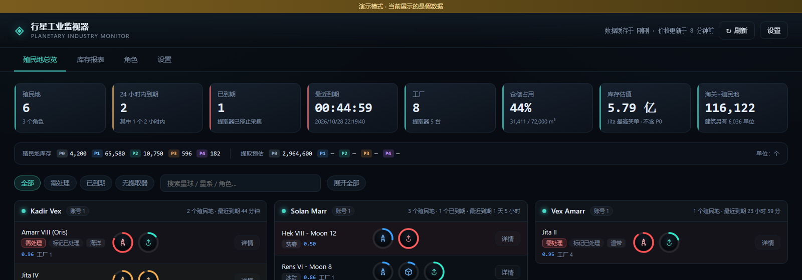

# EVE 行星工业监视器

本地网页程序，登录 EVE Online 账号后查看名下所有角色的行星工业（Planetary Industry）状况：
哪些提取器快到期、哪个殖民地的仓库快满了、工厂在造什么、各层级物资库存有多少。

登录走 **EVE 官方 SSO（OAuth 2.0）**，程序全程不接触你的账号密码。



## 亮点

- **一眼看出谁要爆仓、谁要停产** —— 每个殖民地的仓库占用率、每个提取器的剩余时间都是独立圆环，
  快满了变黄、快到期变红，不用逐个点进去看
- **多角色合并统计** —— 同一账号下所有角色一次拉齐，可以按角色开关参与统计
- **海关 + 建筑库存也管** —— 不止殖民地里那点货，散落在海关和玩家建筑里的 PI 物资一起算
- **Jita 实时估值** —— 接 Fuzzwork 报价，按单个物品的最高买价估算库存值多少钱
- **全中文名词** —— 83 种 PI 物资、行星建筑、行星类型都有官方中文译名，按 type_id 对照不会错位
- **单文件 exe** —— 打包后一个 exe 双击就跑，不用装 Python；数据各自独立，发给朋友也不会串

## 技术栈

Python 3 + Flask + SQLite，前端原生 HTML/CSS/JS 无框架，PyInstaller 打包。
ESI 请求带 ETag 缓存和错误预算退避，尽量少消耗 CCP 的额度。

---

## 一、准备：注册一个 EVE 应用（约 5 分钟）

EVE 的第三方程序必须先在 CCP 的开发者平台登记，拿到一对 `client_id` / `secret`。

1. 打开 <https://developers.eveonline.com/applications>，用你的 EVE 账号登录
2. 点 **CREATE NEW APPLICATION**，填写：
   - **Name**：随便起，例如 `PI Monitor`
   - **Description**：随便写
   - **Connection Type**：选 **Authentication & API Access**
   - **Permissions**：勾选这三个
     - `esi-planets.manage_planets.v1` —— 读殖民地、引脚、发射台库存
     - `esi-assets.read_assets.v1` —— 读资产里的 PI 物资（海关、建筑、货柜）
     - `esi-universe.read_structures.v1` —— 解析建筑名，用来区分玩家建筑和海关
   - **Callback URL**：填 `http://localhost:5000/callback`
3. 创建后页面会显示 **Client ID** 和 **Secret Key**，复制备用（Secret 只显示一次）

> 回调地址必须和程序里填的完全一致。`localhost` 和 `127.0.0.1` 算两个不同的地址，别混用。

## 二、运行

### 方式一：直接跑 exe（推荐）

双击 **`dist\行星工业监视器.exe`**。单文件，不需要装 Python、不需要虚拟环境。

- 想放桌面：右键 exe → 发送到 → 桌面快捷方式
- 重复双击不会开第二份：程序会先探测端口，已经在跑就直接打开页面
- 关掉：**任务栏右下角的托盘图标 → 右键 → 退出**；或页面「设置」页最下面的「退出程序」
- 托盘图标左键双击 / 右键「打开监控」可以直接打开页面

**数据存在哪**

放在用户主目录下，每个用户各自一份：

```
C:\Users\<用户名>\行星工业监视器\
  config.json      Client ID / Secret（明文，别外传）
  data\pi.db        角色、加密的 refresh token、ESI 缓存、库存快照
  data\key.bin      token 的加密密钥
```

设置页「程序」一节会直接显示真实路径。

为什么不放「我的文档」：文档目录常被 OneDrive 接管，云同步会锁住 SQLite 导致读写失败。
用户主目录根不属于 Known Folder，OneDrive 的文件夹备份不会碰它。

- **分享给别人**：只发 exe 就行，对方会在自己的主目录生成独立数据，互不影响
- **绿色便携版**：在 exe 旁边放一个空的 `portable.txt`，数据改放 exe 同级目录（适合 U 盘）

### 方式二：从源码跑（改代码、调试用）

双击 **`启动.bat`**，首次会自动建虚拟环境、装依赖。窗口里的报错能看见。

也可以手动：

```bash
python -m venv .venv
.venv\Scripts\python.exe -m pip install -r requirements.txt
.venv\Scripts\python.exe app.py
```

### 重新打包 exe

改了代码之后，双击 **`打包.bat`** 重新生成，产物在 `dist\`。首次会自动装 PyInstaller。

打包用的是 `--onefile --windowed`：单个文件、无控制台窗口。启动失败会弹系统对话框显示原因。

## 三、能看到什么

**殖民地总览**
- **一个角色一张卡片，一行排 3 张**，卡片头部是角色名，下面是该角色的每个殖民地一行
- 同一账号下的人物会排在一起，卡片头部标注「账号 N」
- 每行用圆环表示状态，多个仓库、多个提取器各自独立显示：
  - **蓝色圆环 + 火箭图标** = 仓库，环的进度是仓储占用率
  - **青色圆环 + 向上箭头** = 提取器，环的进度是**已运行时间**（越跑越满），
    鼠标悬停显示剩余倒计时；每分钟自动重算一次，不用刷新页面
  - 仓储 ≥80% 变黄、≥95% 变红；提取器剩余 <2 小时变黄、已到期变红
  - 鼠标悬停在圆环上能看到具体数值（容量、剩余时间、产物）
- 排序：按行星名（同星系按罗马数字 I、II、IV…），没有提取器的殖民地统一排到最后
- 点每行的「详情」可以展开引脚明细（建筑、产物、库存、路由），「展开全部」一次全开

**顶部指标**
- 殖民地总数、24 小时内到期数、已到期数、最近一次到期时间、工厂数、仓储占用率
- 层级条：P0–P4 的仓储库存 + 提取程序预计产出

**海关 / 建筑库存**
- 从角色资产接口读取放在殖民地之外的 PI 物资，按角色汇总，并计入物资总量
- 海关和玩家建筑在 ESI 里都标成 `location_type=item`，只能靠**解析建筑名**来区分：
  - **建筑** —— 空间站（`station`）、能解析出名字的玩家建筑、以及货柜/飞船内部的物资（顺着父级往上找归属）
  - **海关** —— `item` 但解析不出建筑名的位置
  - `other` 和 `solar_system`（直接暴露在太空里）不统计
- 顶栏「海关库存」指标 + 库存页的角色卡片，卡片悬停可看各处位置的明细（建筑会显示名字）
- 「按物资汇总」视图里，海关和建筑各占一列，总数量仍是全部来源之和

**市场估值（Jita 价）**
- 走 Fuzzwork 聚合接口，取 **Jita 4-4**（空间站 60003760）的报价，一次请求拿全部 83 种 PI 物资
- 刷新规则：**首次打开读一次**；之后 15 分钟内按 F5 不重复读，超过 15 分钟按 F5 才读；
  后台另有固定 **1 小时**的自动刷新，保证长时间不看数据也不过期
- 刷新按钮旁边会显示「数据缓存于 X 前 · 价格更新于 X 前」，一眼看出新鲜度
- 按物资汇总里，每个物资名下显示 **单个物品的 Jita 最高买价**
- 「估值」列 = 数量 × 最高买价（立刻挂单能成交的价，不是卖单最低价）
- 总览顶部「库存估值」= 全部库存的估值合计，**P0 原料不计入**
- 拿不到报价时显示「无报价」，不影响其它功能

**库存报表**
- 「按星球」逐条列出每个殖民地仓库里的物资，支持按**物资名**或**角色名**搜索
- 「按物资汇总」按层级拆成 5 个窗口（P1、P2、P3、P4、P0），一行两个，P0 放最后
- 「来源」列只有两类：**海关+殖民地** 与 **建筑**，合计里也是这么拆的
- 「较上次」列显示与上一次快照的增减（快照间隔至少 10 分钟）
- 可导出 CSV（带 BOM，Excel 直接打开不乱码）

**多角色**
- 「角色」标签页里每个角色一个开关，关掉就把它从统计里移除
- 切换开关后本地立即重算，不发任何网络请求
- 所有统计都是所选角色的合并结果

**名词中文化**
- 全部 83 种行星物资（P0–P4）、行星建筑、行星类型都显示中文名，鼠标悬停可看英文原名
- 物资名采用**游戏内官方中文译名**（如 机械元件、消费级电器、无菌管道、核能燃料）
- 物资按 type_id 对照（见 `core/i18n.py`），ID 比名字稳定，不会被 ESI 改名影响
- 星系名保留英文——玩家普遍用英文星系名（Jita、Amarr），翻译反而不便对照
- 导出的 CSV 同时带中文名和英文名两列

## 四、关于

- 版本：**1.0.0**
- Wisher：EVEer
- Creator：蓝色大肥鱼

## 五、数据与安全

| 项目 | 说明 |
|---|---|
| 账号密码 | 只输入到 `login.eveonline.com`，程序不接触 |
| 授权范围 | `esi-planets.manage_planets.v1` + `esi-assets.read_assets.v1` + `esi-universe.read_structures.v1`，均为只读 |
| refresh token | 用 Fernet 加密后存在 `data/pi.db`，密钥在 `data/key.bin` |
| 撤销授权 | 设置页「移除」，或到 EVE 账号的第三方应用里撤销 |
| 本地缓存 | ESI 响应按 ETag 缓存，减少请求；可一键清空 |
| 凭据显示 | Client ID 和 Secret 在设置页都只显示末 4 位（`****2d28`），留空保存不会覆盖 |
| 刷新间隔 | 设置页可选「手动 / 5 分钟 / 15 分钟 / 30 分钟 / 1 小时」；默认手动，只有点「刷新」才拉新数据 |

`config.json`、`data/`、`.venv/` 都不应该提交到版本库（已在 `.gitignore` 里排除）。

## 六、常见问题

**登录后提示「state 校验失败」**
浏览器把 cookie 拦了，或者你在 `127.0.0.1` 和 `localhost` 之间来回跳。用 `http://localhost:5000` 打开再试。

**提示「权限不足（缺少对应 scope）」**
EVE 应用里没勾 `esi-planets.manage_planets.v1`。去开发者平台补勾，然后移除角色重新授权（旧 token 不会自动获得新权限）。

**提示「授权已失效，请重新登录」**
refresh token 被撤销或超过 30 天没用过。移除角色重新添加即可。

**海关库存是空的 / 提示缺少权限**
去 EVE 开发者后台给应用补勾 `esi-assets.read_assets.v1` 和 `esi-universe.read_structures.v1`，
然后移除角色重新授权——旧 token 不会自动获得新权限。另外资产接口本身有 1 小时缓存，刚发射上去的货可能要等一会。

**建筑和海关分不开**
说明缺少 `esi-universe.read_structures.v1`。这个接口只返回你在 ACL 里的建筑；
解析不出来的位置（包括真正的海关）会被归到「海关」里。

**数据不更新**
程序只在**第一次打开页面**时请求 ESI，之后按 F5 都直接读本地缓存，不会重新拉数据。
要拿新数据请点右上角「刷新」——它会带条件请求（ETag），没变化就不重复下载。

**为什么打开页面时数据是旧的**
这是设计如此：避免每次刷新都消耗 CCP 的请求额度。右上角会显示「缓存于 几点」，一眼能看出数据新鲜度。

**420 / 限流**
CCP 有错误预算，程序会自动读 `X-ESI-Error-Limit-Remain` 并在额度低时退避等待。

## 七、项目结构

```
app.py              Flask 入口，路由与页面组装
core/paths.py       路径解析（区分 exe 同级目录 / 打包内资源目录）
core/config.py      配置读写（config.json / 环境变量）
core/sso.py         EVE SSO 授权、token 交换与自动续期
core/esi.py         ESI 客户端（ETag 缓存、限流保护、类型元数据）
core/pi.py          行星工业数据解析与统计
core/i18n.py        物资/建筑/行星类型的中英文对照表
core/market.py      Jita 报价（Fuzzwork）
core/store.py       SQLite 存储（角色、缓存、快照）
core/demo.py        演示用的假 ESI
templates/ static/  前端页面
tools/selftest.py   解析逻辑自检
tools/make_icon.py  生成 app.ico
启动.bat            源码启动（首次会装环境）
打包.bat            重新打包 exe
dist/               打包产物
```

## 八、用到的 ESI 接口

| 接口 | 用途 | 权限 |
|---|---|---|
| `GET /characters/{id}/planets/` | 殖民地列表 | manage_planets |
| `GET /characters/{id}/planets/{planet_id}/` | 引脚/链接/路由/库存 | manage_planets |
| `POST /universe/names/` | id → 名字 | 公开 |
| `GET /universe/planets/{id}/` | 星球类型与所属星系 | 公开 |
| `GET /universe/systems/{id}/` | 星系名与安全等级 | 公开 |
| `GET /universe/types/{id}/`、`/groups/{id}/` | 物资体积与分组（用于判定 P0–P4） | 公开 |

提取器的「预计总产出」按程序开始时的速率线性估算，实际产量会随矿脉衰减下降，所以这个数字是**上限**。

## 九、免责声明

这是一个非官方的第三方工具，与 CCP Games 无关。

EVE Online 及相关名称、标识是 CCP hf 的商标或注册商标，本项目的使用已遵守
[CCP 第三方开发者协议](https://developers.eveonline.com/)。程序只通过官方 ESI 读取
你自己账号的只读数据，不会修改游戏内任何内容，也不会自动操作客户端。

使用本工具产生的任何后果（包括但不限于误判库存、估值偏差）由使用者自行承担。

## 九、许可

[PolyForm Noncommercial License 1.0.0](LICENSE) © 2026 JuniorWisher

个人使用、学习研究、自行修改和分发都可以，**但不能用于商业用途**——不能把它或改过的版本
拿去卖、打包进付费产品、或用在有营收的公司业务里。慈善机构、学校、公共研究机构、
公共安全与卫生机构、环保组织、政府机构的使用不受此限制。

需要商业授权请通过仓库 Issue 联系作者。
